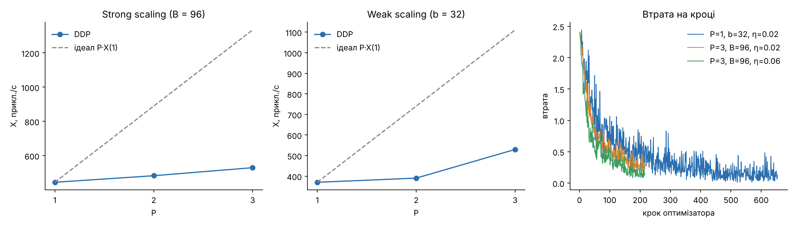

# Лабораторна робота 6. Розподілене навчання нейромережі за даними на CPU (варіант 3)

Варіант 3: датасет **Д3 = OrganAMNIST** (K = 11, C = 1), ширина **Ш3** (c1/c2/h = 64/128/512),
**P_max = 3**, **B = 96** (b = 32), **K_c = 20**, **s_f = 50**. N = 7000, n_ep = 3, SGD (момент 0,9), η₀ = 0,02.
PyTorch (CPU), бекенд gloo, запуск через torchrun, цикл навчання власний.

## Файли
- `train.py` — модель, дані, ручна синхронізація, DDP, вимірювання, контрольні точки, імітація відмови.
- `run_all.py` — уся серія запусків, результати в `results/*.json` (можна перезапускати: готові пропускаються).
- `analyze.py` — таблиці 1–6 (`results/tables.md`) і рисунок `results/lab6_overview.png`.

## Запуск
```
pip install torch numpy scikit-learn matplotlib psutil
python run_all.py            # завантажує organamnist.npz з Zenodo у data/, виконує всю серію
python analyze.py results    # таблиці 1-6 і рисунок
```

## Реалізація
- **Мережа і дані** за умовою (два згорткові шари, hidden FC), перші N = 7000 прикладів train, тест — увесь test (17778).
  n_params = 3 291 915 збігається з формулою, M = 12,56 МіБ.
- **Ручна синхронізація**: `dist.broadcast` ваг з процесу 0, після `backward()` по одному `all_reduce(SUM)` на тензор і ділення на P.
- **DDP**: типовий розмір кошика (25 МіБ). `t_step,ns` вимірюється окремим прогоном з `backward()` усередині `model.no_sync()`.
- **Швидкість**: 10 кроків прогріву + 50 вимірюваних; t_step — медіана 50 кроків процесу 0, X = 50·B/t за годинником
  (`perf_counter`) між початком 11-го і кінцем 60-го кроку. Кожну конфігурацію виконано 3 рази, у таблицях медіана з 3.
- **Втрата на кроці** у логах — середнє за процесами локальних втрат (`all_reduce`).
- **Контрольні точки** кожні K_c = 20 кроків пише процес 0 (`ckpt.tmp` → `os.replace`, потім `barrier`).
  Відмова: процес з rank = 2 на початку кроку 50 створює файл-позначку і викликає `os._exit(1)`.
  Нумерація кроків з 1; на момент відмови виконано 49 кроків.

## Відхилення від умови
1. **Запуск замість torchrun.** Збірка PyTorch для Windows на цій машині не має підтримки libuv, а c10d-rendezvous у `torchrun`
   жорстко її вимагає (`use_libuv was requested but PyTorch was built without libuv support`, ні змінна `USE_LIBUV=0`,
   ні `--rdzv-conf=use_libuv=0` не допомогли). Тому всі групи процесів запущено власним `launch.py`: він задає ті самі змінні
   (`RANK`, `WORLD_SIZE`, `LOCAL_RANK`, `MASTER_ADDR=127.0.0.1`, `MASTER_PORT`) і поводиться як `--max-restarts=1`:
   якщо процес завершується з ненульовим кодом, решту зупиняє і перезапускає всі P процесів зі статичною адресою
   127.0.0.1:29500. Backend gloo і сам цикл навчання від цього не змінюються (див. `results/launcher.txt`).
2. У логах gloo є попередження `socket.cpp: client socket has failed to connect to [whitesummer]:29500 (10049)`:
   ім'я хоста машини не розв'язується в адресу loopback. Група створюється і працює, попередження не впливає на результати.
3. C_phys = 5 (процесор Intel Pentium Gold 8505, за даними виробника це 1 продуктивне й 4 енергоефективні ядра, 6 потоків),
   тому n_th = ⌊5/3⌋ = 1 для всіх прогонів. Ядра нерівнозначні, і це суттєво для результатів нижче.
4. Якість (таблиця 5) виміряно одним прогоном з одним зерном, без повторів, тому різниці в кілька сотих ACC можуть лежати
   в межах розкиду.

## Результати
### Таблиця 1. Стенд

| Процесор | Фізичних ядер C_phys | Логічних ядер | Памʼять, ГБ | ОС | Python | PyTorch | n_th |
| --- | --- | --- | --- | --- | --- | --- | --- |
| Intel(R) Pentium(R) Gold 8505 | 5 | 6 | 23.7 | Windows-11-10.0.26300-SP0 | 3.14.5 | 2.15.0+cpu | 1 |

| Датасет | K | C | c1 / c2 / h | n_params | M, МіБ | N | B | P_max |
| --- | --- | --- | --- | --- | --- | --- | --- | --- |
| OrganAMNIST (Д3) | 11 | 1 | 64 / 128 / 512 | 3 291 915 | 12.56 | 7000 | 96 | 3 |

### Таблиця 2. Синхронізація градієнтів

| Режим | t_step, мс | Час обміну на крок, мс | Частка кроку в обміні | X, прикл./с |
| --- | --- | --- | --- | --- |
| 1 процес, батч B | 195.93 | 0 | 0 | 480 |
| P_max процесів, ручна синхронізація | 187.08 | 46.75 | 0.250 | 507 |
| P_max процесів, DDP | 177.15 | 1.27 | 0.007 | 530 |
| P_max процесів, DDP, no_sync | 175.88 | 0 | 0 | 533 |

| max abs(g − ḡ) / max abs(g) | Різниця сум ваг між процесами після 50 кроків | ACC, 1 процес | ACC, DDP на P_max | AUC, 1 процес | AUC, DDP на P_max |
| --- | --- | --- | --- | --- | --- |
| 3.14e-06 | 0.00e+00 | 0.8009 | 0.8017 | 0.9757 | 0.9761 |

### Таблиця 3. Strong scaling, B = const (96)

| P | b | t_step, мс | t_step,ns, мс | X, прикл./с | S | E | e | c |
| --- | --- | --- | --- | --- | --- | --- | --- | --- |
| 1 | 96 | 211.28 | 209.59 | 445 | 1.000 | 1.000 | − | 0.008 |
| 2 | 48 | 193.31 | 189.69 | 483 | 1.086 | 0.543 | 0.841 | 0.019 |
| 3 | 32 | 177.15 | 175.88 | 530 | 1.192 | 0.397 | 0.759 | 0.007 |

### Таблиця 4. Weak scaling, b = 32

| P | B_P | t_step, мс | X, прикл./с | S_w | E_w |
| --- | --- | --- | --- | --- | --- |
| 1 | 32 | 84.96 | 370 | 1.000 | 1.000 |
| 2 | 64 | 155.64 | 391 | 1.055 | 0.527 |
| 3 | 96 | 177.15 | 530 | 1.431 | 0.477 |

### Таблиця 5. Якість за різних глобальних батчів

| Режим | B_P | η | Кроків оптимізатора за n_ep епох | ACC | AUC | Найбільша втрата за останню епоху |
| --- | --- | --- | --- | --- | --- | --- |
| P = 1 | 32 | 0.02 | 654 | 0.8255 | 0.9814 | 0.4826 |
| P = P_max, з кроку 2 | 96 | 0.02 | 216 | 0.8017 | 0.9761 | 0.5411 |
| P = P_max, лінійне правило | 96 | 0.06 | 216 | 0.8293 | 0.9820 | 0.4343 |

### Таблиця 6. Відмова і відновлення

| K_c | s_f | Крок останньої контрольної точки | Кроків виконано повторно | t_lost, с | t_f − t_c, с | t_r, с |
| --- | --- | --- | --- | --- | --- | --- |
| 20 | 50 | 40 | 9 | 8.78 | 1.64 | 7.15 |

| Крок | s_f-2 | s_f-1 | s_f | s_f+1 | s_f+2 | ACC після n_ep епох |
| --- | --- | --- | --- | --- | --- | --- |
| Втрата, прогін з відмовою | 0.888880 | 0.879470 | 0.786431 | 0.775869 | 0.733366 | 0.8026 |
| Втрата, прогін без відмови | 0.888880 | 0.879470 | 0.786431 | 0.775869 | 0.733366 | 0.8017 |

Найбільша абсолютна різниця втрати між прогонами за всіма кроками: 9.62e-03. Кроків за прогін з відмовою: 216, без відмови: 216.



## Аналіз

**Еквівалентність (крок 2).** max|g − ḡ| / max|g| = 3,1·10⁻⁶ — у межах 10⁻⁶…10⁻⁵, які очікуються для float32 (різний порядок
додавання). Після 50 кроків суми ваг трьох процесів у float64 збіглися повністю (різниця 0), тобто ваги не розходяться без пересилання.
ACC/AUC одного процесу (0,8009 / 0,9757) і DDP на 3 процесах (0,8017 / 0,9761) однакові в межах розкиду.

**Обмін (таблиця 2).** Ручна синхронізація: t_sync = 46,7 мс, 25 % кроку (8 окремих all-reduce після backward, 12,6 МіБ через loopback TCP,
нічого не перекривається). DDP: незаміщена обчисленням частина обміну t_comm,exp = 1,3 мс, c = 0,7 %. Але цю величину не варто
читати буквально: ті самі різниці t_step − t_step,ns для P = 1 (обміну немає) дають 0,8 %–1,6 мс, тобто c на P = 3 не відрізняється
від шуму вимірювання. Крім того, обчислення в різних режимах не збігається: крок без обміну (no_sync) 176 мс, а крок з ручною
синхронізацією за вирахуванням t_sync лише ≈140 мс; обгортка DDP на одному процесі теж додає ≈8 % (211 мс проти 196 мс без неї).
Тому висновок обережний: DDP не гірший за ручну синхронізацію (177 проти 187 мс на крок) і обмін у ньому не помітний
на тлі шуму, а ручна синхронізація з єдиною серією all-reduce після backward коштує чверть кроку. Чому саме так відрізняється
час обчислення, я не з'ясовував (ймовірні причини: накладні DDP і нерівність ядер процесора).

**Масштабування (таблиці 3, 4).** Strong: S(2) = 1,09, S(3) = 1,19, E(3) = 0,40; weak: S_w(3) = 1,43, E_w(3) = 0,48.
Це далеко від ідеалу. Метрика Карпа-Флатта e = 0,84 і 0,76 велика, але **не зростає з P**, а частка обміну c ≈ 1–2 %: за умовою
це ознака того, що втрата ефективності не з обміну градієнтами, а з того, що обчислення кроку на процес не прискорюється.
Це видно й у weak scaling: час кроку при фіксованому b = 32 зростає 85 → 156 → 177 мс зі збільшенням числа процесів, хоч
у no_sync немає жодного обміну (176 мс при P = 3). Тобто одночасно працюючі процеси гальмують один одного: по одному потоку
на процес, 5 ядер різного типу на 6 потоків, спільні кеш і пам'ять, можливі обмеження частоти. Одиночний процес
працює швидше (імовірно, на найшвидшому ядрі), а додаткові процеси потрапляють на повільніші. Цю причину я висуваю як
пояснення, окремо її не перевіряв (наприклад, закріпленням процесів за ядрами). На GPU, де обчислення швидше, частка обміну була б більшою.

**Якість за різних батчів (таблиця 5).** За ті самі 3 епохи P = 1 з b = 32 робить 654 кроки, три процеси з B = 96 — 216, тобто
втричі менше оновлень ваг. З тим самим η₀ = 0,02 це дає нижчу якість: ACC 0,8255 → 0,8017, AUC 0,9814 → 0,9761.
Лінійне правило (η_P = 0,06) повертає якість: ACC 0,8293, AUC 0,9820, найбільша втрата за останню епоху 0,434 проти 0,541. Розходження
навчання немає (втрата не зростає від кроку до кроку, на перших кроках обидва η дають однакові значення), розігрів не потрібен.
Це один прогін на режим, тому різницю між P = 1 (0,8255) і лінійним правилом (0,8293) не слід вважати значущою,
а різниця 0,8017 → 0,8293 (≈ 0,03) помітно більша за розкид між двома майже однаковими прогонами (≈ 0,001, див. нижче).

**Відмова і відновлення (таблиця 6).** Остання контрольна точка перед відмовою — крок 40; відмова на початку кроку 50, коли виконано 49 кроків,
тому повторно виконано 49 − 40 = 9 кроків (в середньому очікується K_c/2 = 10). t_lost = 8,8 с: (t_f − t_c) = 1,6 с втраченої роботи
плюс t_r = 7,2 с на зупинку групи, повторний старт трьох процесів (імпорт torch, читання даних), створення групи і читання контрольної точки;
з нього основна частка — перезапуск, а не втрачені кроки. Відновлення відбулося з правильного місця (крок 40, епоха 0, 40 батчів пропущено).
Втрата на кроках 48–52 у прогоні з відмовою збігається з прогоном без відмови до 6 знаків. Повного збігу всіх 216 кроків немає: різниця
спочатку близько 10⁻¹¹, потім на рівні float32 (10⁻⁷) і далі зростає (10⁻⁵ після кроку ≈ 84, до 10⁻² наприкінці);
ACC 0,8026 проти 0,8017. Така різниця є і до відмови: на кроках 1–49, до перезапуску, прогін з відмовою вже відрізняється від прогону без відмови
на рівні 10⁻¹¹…10⁻⁷, тобто два прогони без втручань теж не байтово ідентичні (імовірно, порядок додавання
в all-reduce або потоків), а крива навчання потім підсилює цей шум. Тому вимога «втрата збігається» виконана з точністю float32 на
кроках навколо відмови, а не побітово на всьому прогоні.
